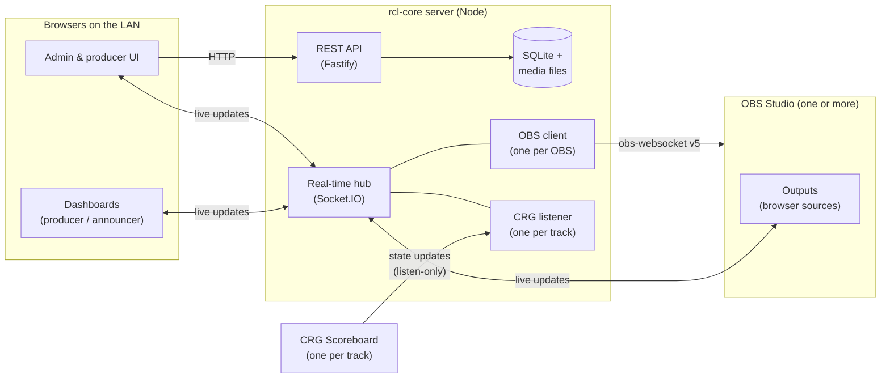

# Architecture overview

How Rollcall fits together. This page describes the **intended** architecture, set out in the [ADRs](../decisions/README.md). Once code exists, update this page to match the code, and record any change of direction in a new ADR.

## System at a glance

Everything runs on the venue network and nothing needs the internet ([ADR-0019](../decisions/0019-rcl-apps-as-modules.md)).

## Pieces

These workspaces are planned in [ADR-0017](../decisions/0017-rcl-app-workspace-layout.md).

| Workspace | Responsibility |
|---|---|
| `rcl-core/server` | The one server process: hosts every rcl app as a module ([ADR-0019](../decisions/0019-rcl-apps-as-modules.md)), plus core's own REST API, Socket.IO hub, accounts and access checks, SQLite, media storage, the font library (bundled fonts at `/fonts/<family>/<file>`), one connection per OBS and CRG instance, automation engine and live state |
| `rcl-core/web` | React SPA for rcl-core's admin GUI: setup, sign-in, users and the data editors, served at `/core/` |
| `rcl-core/contract` | Zod schemas and TypeScript types for core's API, socket messages and import/export formats, used by server and web |
| `rcl-producer/server` | The Producer app's module: its routes, namespaces (such as the overlay's `/producer/overlay`) and tables, hosted by rcl-core |
| `rcl-producer/contract` | Zod schemas and types for the Producer app's API and socket messages |
| `rcl-producer/web` | React SPA for the builders, Live Mode and dashboards, served at `/producer/`. A separate lightweight **overlay entry** at `/producer/overlay` renders outputs for OBS |
| `packages/app-sdk` | The types an app module is written against: `AppModule`, `AppContext` with core's read-only data services ([ADR-0023](../decisions/0023-core-data-services-for-apps.md)), `Access` and permissions |
| `packages/web-sdk` | Code every app's Mantine GUI shares: the app shell, the sign-in gate that sends people to rcl-core's sign-in page and back, the account menu, the server badge, the RTK Query base API and store, and the dev proxy. Overlay entries never use it |

## How apps are hosted

rcl-core's server hosts each rcl app as an [app module](../product/glossary.md#app-module), on one port ([ADR-0019](../decisions/0019-rcl-apps-as-modules.md)).

- **Routes.** An app's routes are at or below `/api/<id>`, such as `/api/producer` and `/api/producer/themes`. Each one declares who may call it ([ADR-0018](../decisions/0018-declared-access-and-permissions.md)), and the server won't start with a route that no hosted app owns. Every `/api` route is registered inside one plugin, which does the cross-site check and finds the caller. A route registered outside it fails closed: the server won't start with a public one, and any other refuses everyone.
- **Web builds.** An app's build is served at `/<id>/`. Its real files are served as they are. Every other path below `/<id>/` gets one of the app's pages, such as `/producer/overlay`, or its `index.html`, so client-side routes load. A path that looks like a file, under `assets/` or with an extension, never gets a page: a missing one is a 404. A page left open across an upgrade that asks for an old hashed asset gets an error, not HTML.
- **Core's data.** Apps read core's data only through read-only services on `AppContext`, never core's tables ([ADR-0023](../decisions/0023-core-data-services-for-apps.md)). `ctx.fonts.list()` gives the font library and `ctx.teams` gives the teams: `list()` the summaries, `get(id)` a team with its members, in the shapes core's teams routes return.
- **Reserved ids.** An app can't take an id that the server's own paths use: `api`, `docs` (the API explorer), `media` ([ADR-0022](../decisions/0022-public-media.md)) and `fonts` (bundled fonts). `socket.io` can't be an id anyway, since ids are lowercase letters, digits and dashes. An app with a reserved id is skipped at startup with an error in the log, like any app that fails its startup checks.

## How data flows

**Setup time.** The admin UI reads and writes teams, themes and screens through the REST API. In the browser, that data lives in the RTK Query cache ([ADR-0003](../decisions/0003-client-state-with-redux-toolkit.md)).

**Live.** The server is the single authority for live state ([ADR-0019](../decisions/0019-rcl-apps-as-modules.md)).

1. When CRG pushes a state update to the server's listener for that track:
   1. The listener diffs the update against the previous state and detects game events ([CRG integration](integrations/crg-scoreboard.md#detecting-game-events)).
   2. The server evaluates [automation](../features/crg-automation.md) rules and updates live state.
   3. The server broadcasts the change to the right Socket.IO rooms: per track, per output, per dashboard.
2. When a producer acts on a dashboard:
   1. A socket event goes to the server.
   2. The server checks the caller's access ([ADR-0018](../decisions/0018-declared-access-and-permissions.md)).
   3. The server updates live state or sends an OBS request.
   4. The server broadcasts the result.
3. Outputs, dashboard previews and the builder canvas all render with the same presentational overlay components, so every view matches what's on air ([ADR-0006](../decisions/0006-one-overlay-renderer-css-variable-theming.md)).
4. When an output reloads, whether OBS restarted it or it was hidden and shown again, it rebuilds its entire state from the server.

**Socket.IO namespaces.** Each rcl app has its own namespaces, at or below `/<id>`, and each one declares who may join, as each API route does ([ADR-0018](../decisions/0018-declared-access-and-permissions.md)). The OBS overlay's `/producer/overlay` is public, so OBS outputs need no login until output token URLs arrive. It sends each overlay the [default theme](../product/glossary.md#default-theme) when it connects, and again whenever that theme changes. An overlay for a [skater intro](../features/skater-intros.md) names the intro when it connects and joins that intro's room instead: it gets the intro's theme, and only what's on air and who's next, again after every change. Signed-in namespaces check the session cookie when a client connects, such as the intros' control pages on `/producer/intros` (needing `producer:intros.run`) and, later, Live Mode's dashboards. The bare `/` namespace refuses everyone.

## Key decisions

Summaries only. The ADRs are canonical.

- [ADR-0003](../decisions/0003-client-state-with-redux-toolkit.md): Redux Toolkit; server data only in RTK Query.
- [ADR-0005](../decisions/0005-crg-is-listen-only.md): CRG is listen-only, and there are no score displays.
- [ADR-0006](../decisions/0006-one-overlay-renderer-css-variable-theming.md): One overlay renderer; themes as CSS custom properties.
- [ADR-0018](../decisions/0018-declared-access-and-permissions.md): Server-side sessions; every route and namespace declares its access, checked by permission; a public overlay until output token URLs arrive.
- [ADR-0019](../decisions/0019-rcl-apps-as-modules.md): rcl-core's server hosts every rcl app as a module, owns live state and all external connections, and works offline. Each app has its own Zod contract, and import/export files are versioned.
- [ADR-0020](../decisions/0020-api-keys.md): API keys for devices and scripts, with their own permissions and never people-only ones; the `Authorization` header beats the cookie.
- [ADR-0022](../decisions/0022-public-media.md): Uploaded images are files in the data folder, served to anyone at unguessable `/media/<id>` addresses, so OBS overlays can show them.
- [ADR-0023](../decisions/0023-core-data-services-for-apps.md): rcl-core shares its data with apps through read-only services on `AppContext`, fonts and teams so far; apps never read core's tables.
- [ADR-0024](../decisions/0024-import-export-kinds.md): rcl-core reads and writes export files at `/api/core/transfer/…`; each app owns its kinds of item, and one import is one transaction.

## More

- [Data model](data-model.md): domain entities and how they relate
- [CRG scoreboard integration](integrations/crg-scoreboard.md)
- [OBS WebSocket integration](integrations/obs-websocket.md)
